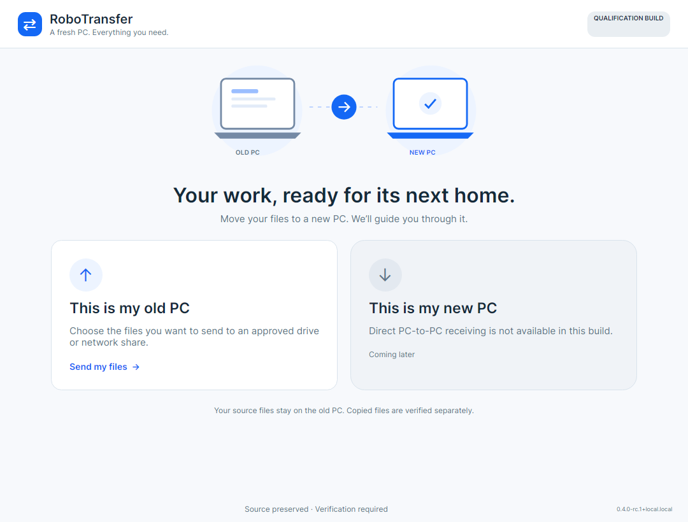
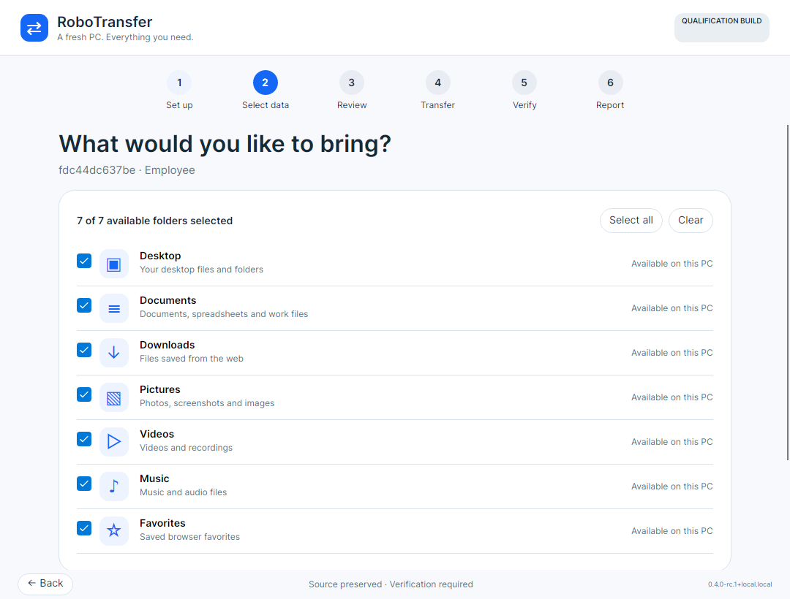

# Guided PC migration

RoboTransfer uses a Smart Switch-inspired interaction pattern: choose this PC's role, select what to bring, review, transfer, verify, then save a report. The application keeps its own identity and uses native Avalonia controls and bundled Inter typography.





## Behavior

- The old-PC action begins setup. Direct receiving on the new PC is explicitly unavailable; there is no implied pairing service or receiver.
- Analyze the endpoint and choose a registered employee profile and a policy-approved drive or UNC share. Technical details and unfinished sessions live in expanders.
- Select all or clear only available Known Folders. Changing source, folder selection or destination discards stale scan/approval evidence.
- A completed scan advances to review. Confirming the plan locks selections and advances to transfer.
- The transfer displays actual completed files and bytes against eligible manifest totals. No throughput, ETA or percentage is simulated. Progress updates occur when the engine completes a file, so a large file can leave the percentage stationary while copying.
- Navigation and selection cannot interrupt a running operation. Cancellation remains explicit. Locked plans cannot be edited through Back.
- Verification becomes available only after transfer reconciliation succeeds. Failed/cancelled verification can be reported, but never displays a green success state.
- Retrying failed verification items merges the new results with the existing verified evidence for the same plan and manifest.
- Starting another migration clears the old profile, plan, counters, verification and report location. Durable session/report files remain available on disk.

## Preview and validation

The screenshots above are rendered from the actual XAML with offline sample data. Regenerate them, including a 900 × 650 viewport check, using:

```powershell
dotnet run --project tools/UiPreview/UiPreview.csproj -c Release -- artifacts/ui-preview
```

The preview harness does not analyze endpoints, scan folders or transfer files. Windows CI uploads these native renders as `RoboTransfer-native-ui`. Runtime-dependent trust validation and managed-device transfer qualification still require Windows; a headless screenshot is layout evidence only.

The platform-neutral core test project compiles the UI-independent wizard and coordinator sources to exercise navigation gates, cancellation, selection invalidation, copy/verification/report, targeted retry and reset. Production builds compile those same sources in the Avalonia application.
