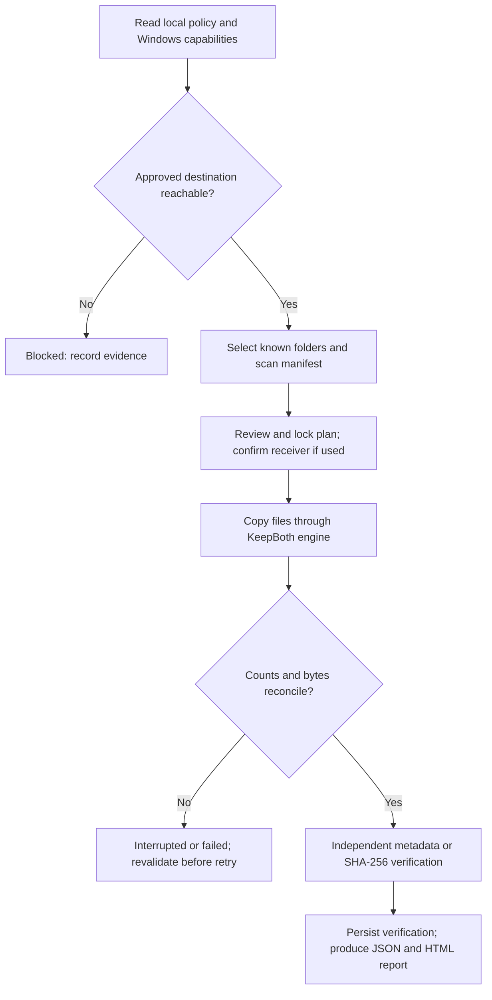

# RoboTransfer end-to-end network validation

Date: 2026-11-03 (UTC). Qualification work; not production approval.

## Scope and evidence rules

This work extends receiver-inbox commit `5481bb1e81a78c074bd34ebb7e59a86d909ce762` (open PR #7). Main is `8fa9b5a81866cbf09f4a74a24bad731a5734ce08`; main does not yet have the receiver inbox. Neither branch has the old UDP discovery/six-digit TLS transport. The current design deliberately uses Windows-authenticated, policy-listed SMB shares or permitted external media.

PASS means a stated expectation was observed in the stated environment. FAIL means a requirement was violated. BLOCKED means a prerequisite prevented the test. NOT RUN means no execution evidence exists. A passing CI job is not proof that every migration requirement passes: the characterization harness deliberately reports the known duplicate-on-resume limitation as FAIL. Read its matrix, not just the green job icon.

Baseline evidence, before this change: [Windows CI 40496969767](https://github.com/LIANN-DARDS900/Data-Transfer/actions/runs/40496969767), job 122164755326, 2026-10-27, **116 core + 42 Windows tests passed; zero build warnings/errors**. Dependency audit reported no vulnerable application packages using that run's sources. [Release validation 40496969920](https://github.com/LIANN-DARDS900/Data-Transfer/actions/runs/40496969920) passed for the same commit. These are historical results, not new network validation.

Current-run results and build links are recorded in `Network-Validation-Results.md` after execution. `qualification.json` and `qualification.html` contain scenario evidence from each actual harness run. `per-file-verification.json` has the individual synthetic-file outcomes and SHA-256 hashes.

## Application pipeline



1. Missing/invalid policy defaults to deny; the app does not create shares, accounts, firewall rules or network listeners.
2. Windows capabilities distinguish allowed mechanisms from available tools. UNC accessibility uses the current Windows identity. `Directory.Exists` gives a coarse availability result, not the cause of a failure, and its underlying SMB call has no application-level hard timeout.
3. Scan inventories selected registered Known Folders. It records locally available file metadata into a versioned JSONL manifest and writes a completion footer. Reparse entries, OST caches and inaccessible entries increment exclusion/warning counts; some excluded paths are not written as individual manifest entries.
4. The optional new-PC inbox requires an existing approved share hosted by that PC. The operator confirms the receiver identity. The eight-character inbox code identifies an offer; it is not a secret and does not replace Windows SMB authentication.
5. The coordinator calls `KeepBothTransferEngineFactory`. This .NET stream engine uses create-new collision handling, 128 KiB asynchronous sequential buffers and write-through destination files. The normal UI is not streaming bytes over a custom app protocol.
6. A separate `RobocopyExecutor` and constrained argument policy exist. `/Z`, `/XJ`, bounded retries and preservation-oriented options are configured. It returns process success, not measured per-file counts. It is tested separately and must not be described as the default UI path. The coordinator currently only supports KeepBoth despite the broader policy enum; other conflict modes need implementation or must remain unconfigured.
7. Copy reconciliation is not verification. Strong mode reads current source and destination bytes and compares SHA-256. The normal successful end is durable verification followed by a final report, and optional receiver-side report delivery. Do not delete the source merely because copy counters reach 100%.

## Findings and fixes

| Finding | Result / action |
|---|---|
| Every PST I/O exception was labelled FileLocked, including network errors | Fixed: only Windows sharing/lock error codes 32/33 are FileLocked, independently of filename extension. Other I/O faults remain unknown rather than guessed to be security blocks. Regression cases inject errors 32, 33, 53 and 64. |
| Destination-directory creation could throw outside per-item error handling | Moved inside per-item handling, so directory I/O/access failures produce an explicit transfer failure. |
| SHA-256 content mismatches were absent from mismatch totals | Fixed and regression assertion added. |
| HTML omitted transfer elapsed, effective rate and warning details | Added scan/copy/verification timings, logical copy MiB/s and HTML-escaped warnings. Zero duration is Not measured. |
| KeepBoth resume creates further collision copies | Open limitation. Resume revalidates identity, policy, tool and destination, then repeats the manifest. No persistent completed-file receipt or byte-offset continuation exists in this engine. Controlled cancellation removes its owned partial candidate when possible; network disconnection can prevent cleanup. |
| KeepBoth verifier infers the destination candidate from size/time | Open qualification risk: matching metadata on an older collision may select the wrong file. A durable per-session source-to-destination receipt is needed. The report can also show the original relative destination instead of the renamed candidate. Treat collision-heavy migrations as unqualified. |
| Exclusion count is named SkippedCloudContent in report JSON | Existing schema aggregates scan exclusions. HTML now labels it Excluded items (all scan reasons). Do not infer all exclusions were cloud files. Per-path reasons for every scan exclusion remain incomplete. |
| System executable trust, safe paths, no destructive Robocopy switches | Existing controls retained. This work changes no security settings. |

This is a test-ready alpha. Duplicate resume and collision mapping are qualification blockers, not claims of a finished production migration engine.

## Files: excluded, failed, or transferable

| File / condition | Actual application rule | What testing establishes |
|---|---|---|
| `.ost` | Explicit scan exclusion; Outlook cache is not migrated | OST fixture should not arrive. This is not an EDR extension block. |
| `.pst` | No extension ban; ordinary stream copy | Closed readable file can copy. Exclusive locks fail. A real Outlook/PST consistency test remains required; close Outlook first. |
| `.txt`, `.pdf`, `.docx`, `.xlsx`, `.jpg`, `.png`, `.zip`, `.mp4` | No application extension allow/deny list | Harness uses inert bytes with these extensions; successful copying does not prove valid documents/media render or that corporate DLP allows their contents. |
| `.exe`, `.ps1`, `.bat` | No application extension ban | Inert fixture bytes are copied but never executed. This is not signature, malware, application-control or DLP qualification. No EICAR/malware samples are used. |
| Online-only/partial/unavailable/unknown cloud content | Excluded; no forced download | Unit fixtures establish classification only. Real OneDrive hydration/pinning remains a device test. |
| Reparse points/junctions/symbolic links | Scanner excludes them before cloud classification | Even some hydrated cloud files represented as reparse points can be excluded. Confirm actual scan output on the Dells. |
| Locked or access-denied files | Fail per item where the engine can classify the OS error | Do not disable controls or force backup privilege to read them. |
| Unicode names/zero bytes | No extension-based restriction | Real fixture copy and strong verification in the harness. |
| EFS, ADS, ACL/owner/audit metadata, very long paths, FAT32 >4 GiB | Not fully qualified | Main-content SHA-256 does not prove metadata preservation or filesystem compatibility. Do not assume KeepBoth has Robocopy's `/COPY:DAT` semantics. |

## How to identify the blocking layer

| Layer | Useful evidence | What it does not prove / next step |
|---|---|---|
| Physical Ethernet | Both adapters Up, negotiated speed, error counters, cable/port substitution under normal operating procedure | Up does not prove IP or SMB; no cloud test certifies cable category or quality. Record actual cable marking, NICs and adapters. |
| IP and routing | Addresses/prefixes, chosen route, interface indices and neighbours on BOTH machines | Check matching subnet and the route to the peer. APIPA can work on a direct link when both ends use compatible addresses; it is not by itself a failure. A failed ping can be ICMP filtering. |
| TCP | Explicit peer TCP-445 probe, listening socket and service evidence | Connected proves a TCP handshake only. Timeout can mean filtering, missing route or unavailable host. Refusal can mean no listener. Neither identifies OCP/EDR as the cause. |
| SMB authentication/authorization | SMB event IDs/time, account context checked locally, dialect/signing/encryption, share and NTFS permissions reviewed by owner | TCP may work while share access fails. Do not enable guest, SMB1, weaken signing or collect passwords. |
| Application policy | Policy validity, exact approved UNC, planner reasons and source identity | A deliberate policy-denied plan is expected behavior, not a networking defect. |
| Application implementation | Same approved path works in Windows, but app fails with a reproducible fixture and correlated logs | Compare conflict mode, manifest and exception evidence; classify as an app defect only with this evidence. |
| Endpoint/corporate policy | Effective rule source, relevant Defender/AppLocker/CodeIntegrity/SMB events and administrator confirmation | EDR presence alone is not evidence that it blocked the transfer. Escalate specific host/time/operation/error to the policy owner. No fallback transport is automatically authorized. |

The collector records candidate firewall rules, not a complete Windows Filtering Platform decision trace. Port ranges, application/service/address/interface scope, IPsec and vendor drivers can affect the final result. Some logs and settings require elevation; UNAVAILABLE means missing evidence, not disabled protection. It does not enable logging or change audit policy.

## Infrastructure, cost and unexecuted tests

The repository is public. Standard `windows-2025` hosted compute is free for public repositories. Separate jobs are separate VMs; this alone does not create a private two-machine SMB lab. No public SMB exposure, overlay tunnel or cloud account provisioning is performed.

The new workflow runs the real solution/tests, PowerShell 5.1 parsing and collector, a one-runner local-filesystem harness, an optional encrypted authenticated loopback SMB fixture under existing runner policies, and Windows publishing. The loopback share is limited to the current runner identity and removed afterward. There are no account, service, adapter or firewall changes. Loopback SMB results are explicitly not two-host or RJ45 results.

No new artifact/cache upload is configured, because account-wide storage usage cannot be verified. Published binaries are generated on the runner and hashes are logged; `Build-TestKit.ps1` reproduces the payload. A separately delivered test-kit archive, if available, is identified in the results record. No chargeable resources are used.

Two real Windows machines under a controlled existing private network remain required for bad-credential tests, host firewall deny-445 injection, actual connection drops, reauthentication and physical performance. No such pair is connected to this session. These tests must be marked NOT RUN/BLOCKED, not simulated and promoted to PASS. `Invoke-TwoMachineValidation.ps1` automates source-side diagnostics and the engine harness against an existing approved receiver share; it provisions no machines or shares.

## Native authenticated encrypted protocol evaluation

| Option | Benefits | Preconditions / limitations |
|---|---|---|
| Existing SMB 3 with Windows authentication and required encryption on an approved share | Current architecture; existing Windows identity and administration | Requires an authorized reachable SMB path. App currently inherits SMB security settings; it must not claim encryption solely because TCP connected. Record negotiated security. |
| Approved SFTP service | Mature authentication/encryption/resumption ecosystem independent of SMB | Requires a separately approved server/service, host-key verification and managed identity/keys. Not installed or tested here. |
| Future native .NET TLS transport | Can give the app explicit framing, progress, integrity and resume semantics | New inbound listener and protocol change conflict with accepted ADR-003 until explicitly superseded by an approved design. Not implemented or validated here. |

If a native protocol is authorized, use standard TLS via `SslStream`, verified peer certificates or managed mutual TLS, OS-protected keys, explicit recipient confirmation and rate-limited pairing. An inbox code alone is not authentication. Define versioned bounded framing, traversal/reparse rejection, disk limits, cancellation, durable source/destination receipts and acknowledged chunk offsets; validate chunks and the complete SHA-256 before committing a file. Reject unknown/untrusted peers and downgrades. Record the approved port and firewall requirements. Do not camouflage traffic on 443 or tunnel around a denied SMB path. Being encrypted does not grant permission to transfer corporate data.

## Physical Dell checklist

1. Keep originals/backups. Use this qualification build only with synthetic fixtures first. Record branch/commit, Windows versions, machine roles and the actual cable marking; record both NIC capabilities and negotiated link speeds.
2. Connect the cable. Run the collector on both PCs, optionally elevated if your authorization permits read access to protected logs. It makes no configuration changes:

   ```powershell
   powershell.exe -NoProfile -File .\Get-NetworkDiagnostics.ps1 -Peer OTHER-PC-IP -OutputDirectory C:\Temp\RT-Before
   ```

   If execution policy blocks an unsigned script, use your organization's approved signing/execution process. No machine or process execution-policy bypass is required by this kit.

3. Compare adapter state, prefixes/routes and explicit TCP 445. Confirm the route actually uses Ethernet, not Wi-Fi/VPN. Retain both reports locally; they contain internal metadata.
4. Have the authorized owner provide an existing receiver-hosted share and exact approved JSON policy. Confirm normal Windows authentication, NTFS/share permissions and free space. If SMB is denied, stop this route and request an approved mechanism; do not alter protections.
5. Run the automated synthetic qualification from OLD against that exact share:

   ```powershell
   .\Invoke-TwoMachineValidation.ps1 -Peer 169.254.10.2 -ApprovedShare '\\NEWPC\ApprovedMigration' -PolicyPath C:\Approved\policy.json -OutputDirectory C:\Temp\RT-Run-001
   ```

6. Review `qualification.html`, JSON and per-file verification. Confirm every eligible file hash and OST exclusion; record failures rather than rerunning until they disappear. Preserve the source and destination test folders as evidence. The harness intentionally tests duplicate resume and locks, and leaves only synthetic data.
7. In the UI, select Old/New roles, prepare the inbox on NEW, compare receiver/employee/code on OLD, select approved Known Folders, scan, review, lock the plan, copy, verify strongly and generate the report. Expected result is Success or explained SuccessWithWarnings; mismatches/incomplete copying are failures. Receiver files land under `Files/<KnownFolder>`, not merged automatically into a Windows profile.
8. In an authorized lab only, test unplug/reconnect and source process restart with synthetic data. Do not add deny rules or use wrong corporate credentials merely to trigger a failure. Current KeepBoth resumes restart file copies and may duplicate completed files; that limitation must remain on the acceptance sheet.
9. Measure at least three first-copy runs into new empty test destinations for large random files and separately many small files. Use 1 GiB or larger only after confirming capacity. Record bytes, copy seconds, scan/verification time, disk types, SMB security and both link speeds. `Measure-Report.ps1` reads the app's final JSON without modifying it.
10. Effective MiB/s = copied bytes / copy seconds / 1,048,576. Megabits/s = copied bytes × 8 / copy seconds / 1,000,000. Neither is negotiated line speed. No measured speed between the two physical Dells is available until these runs occur. A lab runner's local or loopback rate must never be presented as Dell RJ45 performance.

## Acceptance matrix

| Test | Required environment | Initial status |
|---|---|---|
| Baseline 158 tests and previous release | Historical Windows CI, PR #7 commit | PASS (historical only) |
| Updated solution tests / publish / PS5.1 syntax | New Windows CI | See results record |
| Synthetic extensions, Unicode, zero byte, SHA-256 | New local/loopback CI and physical harness | See individual qualification JSON |
| Same-size corruption rejected | Actual verification engine | See results |
| Windows lock vs network error classification | Regression tests with injected Windows codes | See results; not real network blocking |
| Cancellation partial cleanup and retry | Deterministic injected cancellation | See results; not cable unplug |
| Resume is idempotent / byte-offset continuation | KeepBoth repeated run | Known requirement FAIL / unsupported |
| Correct collision destination receipt | Strong verification of multiple collision candidates | Open blocker, not qualified |
| Two-host SMB success and authentication failure | Two independent authorized Windows machines | NOT RUN |
| Actual TCP-445 deny/recovery | Isolated two-host lab with owner authorization | NOT RUN |
| Cable disconnect/reconnect during copy | Physical Dell pair | NOT RUN |
| Dell transfer speed, valid Office/PST/OneDrive and corporate DLP | Physical managed endpoints | NOT RUN |

## Primary references

- [GitHub standard hosted runner scope and public compute](https://docs.github.com/en/actions/reference/runners/github-hosted-runners)
- [GitHub Actions compute/storage billing](https://docs.github.com/en/billing/concepts/product-billing/github-actions)
- [Microsoft Robocopy: restartable mode, options and exit codes](https://learn.microsoft.com/en-us/windows-server/administration/windows-commands/robocopy)
